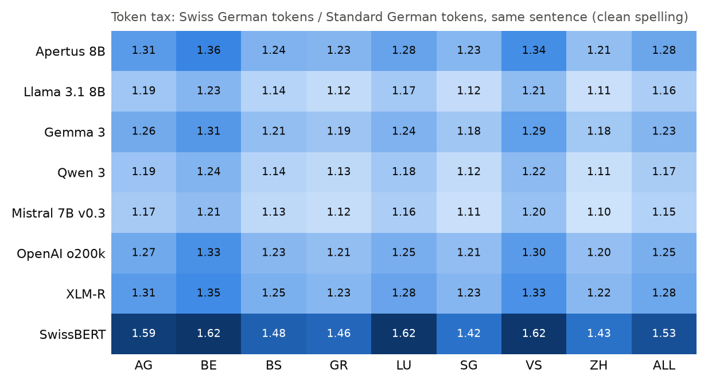

# gsw-eval

An open benchmark for large language models on written Swiss German.

**Question.** What does Swiss German cost when you use an LLM, and how much of that
cost comes from spelling rather than from dialect?

**Measures.**
- **Normalization quality:** Swiss German to Standard German, scored with chrF against the
  Standard German reference, with 95% bootstrap intervals.
- **Spelling robustness:** the same sentences as careful spelling, texting style and
  character noise (Aepli and Sennrich, 2022).
- **Token tax:** tokens for a Swiss German sentence divided by tokens for the same sentence
  in Standard German, for nine tokenizers.

**Baselines.** Lower bound: identity, the dialect text copied unchanged.
Upper bound: the model receives the Standard German sentence itself.

**Models.** Apertus 8B (Swiss), Llama 3.1 8B (same size, not Swiss), Claude Sonnet 5.5.

Course project, Essentials in Text and Speech Processing, University of Zurich, HS 2026.
Team: Erik Avtandilyan, Simone Martinecz, Kelvin Myers.

## Results so far

See [`results/summary.md`](results/summary.md) for every number with its interval.



## Setup

```bash
uv venv && source .venv/bin/activate
uv pip install -e ".[dev,mlx,api]"   # mlx needs Apple Silicon; api needs a key in .env
cp .env.example .env
```

## Data

SwissDial v1.1 (Dogan-Schönberger et al., 2021, CC BY-NC 4.0) is not redistributed here.
Request it from ETH Zurich and put the text files under `data/swissdial/` (see
`data/README.md`). Only sentences available in all eight dialects are used (2,297 after
removing code-switching). The fixed split is in `splits/swissdial_v1.json`: 500 test and
50 dev sentence ids, so 4,000 test inputs per condition.

## Run

```bash
gsw-eval tax                                  # token tax table, no model needed
gsw-eval run --model apertus-8b --split dev --limit 20   # quick pilot
gsw-eval run --model apertus-8b               # full test split, all conditions
gsw-eval report                               # results/summary.md and results/figures/
pytest
```

Models: `identity`, `apertus-8b`, `llama-3.1-8b`, `claude-sonnet-5.5`, and the bf16
variants `apertus-8b-bf16`, `llama-3.1-8b-bf16` for checking the effect of 8-bit quantization.

## How it works

| Module | Does |
|---|---|
| `data.py` | loads SwissDial and the fresh set, makes the fixed split |
| `noise.py` | texting-style rules (`rules/texting_v*.tsv`) and character noise, seeded per sentence |
| `models.py` | MLX and Claude adapters behind one interface, with an output cache |
| `run.py` | builds the four input conditions, scores them, splits dialect cost from spelling cost |
| `metrics.py` | chrF, bootstrap and paired bootstrap, Cohen's kappa |
| `tax.py` | token counts and the token tax |
| `report.py` | tables and figures |

Every model output is stored in `results/cache/<model>.jsonl`, keyed by model, prompt and
input. The cache is committed, so all scores can be recomputed without a GPU or an API key.

## Reproduce every number in the report

```bash
scripts/reproduce.sh
```

## Use of AI assistants

Code was written with AI coding assistants (Claude Code) and reviewed by the team.
