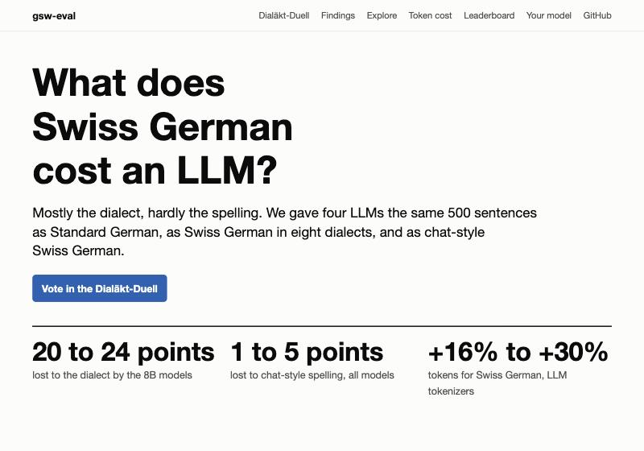
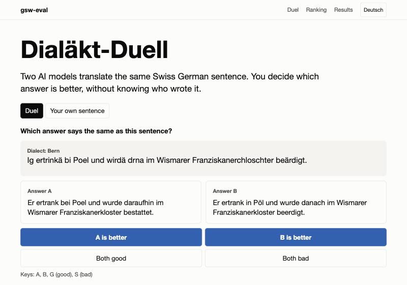
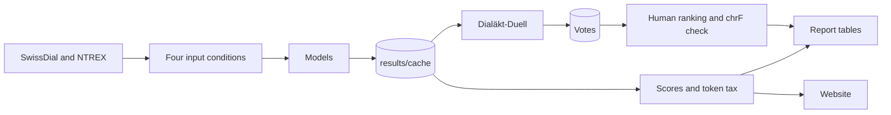

# gsw-eval

[](https://github.com/Eroavt/gsw-eval/actions/workflows/tests.yml)
[](LICENSE)

**What does Swiss German cost a large language model, and how much of it is the dialect rather
than the spelling?**

gsw-eval is an open benchmark for LLMs on written Swiss German. It feeds a model the same sentences
as Standard German, as careful Swiss German in eight dialects, and as chat-style Swiss German. The
difference between those scores splits the cost into a dialect part and a spelling part, in quality
and in tokens, with confidence intervals. The short answer: mostly the dialect, hardly the spelling.

| Results website | Dialäkt-Duell |
|---|---|
|  |  |
| Findings, every model's answer sentence by sentence, a token counter that runs in the browser, and the leaderboard. | Native speakers vote blind on two model answers. The votes give a human ranking and test the automatic metric. |

## What is in this repository

| Part | Where | Purpose |
|---|---|---|
| Benchmark | [`src/gsw_eval/`](src/gsw_eval/) | Data, input conditions, models, scoring, token tax, report tables |
| Results | [`results/`](results/) | Every raw model output and every score, committed |
| Website | [`site/`](site/) | Static results page, no build step |
| Arena | [`arena/`](arena/), [`api/`](api/) | Backend of the blind voting tool |
| Report | [`report/`](report/) | The paper, in ACL style |



## Quick start

Reproduce every number in the report. No GPU and no API key: all model outputs are in the repository.

```bash
git clone https://github.com/Eroavt/gsw-eval.git && cd gsw-eval
uv venv && source .venv/bin/activate
uv pip install -e ".[dev]"
scripts/reproduce.sh
```

You need SwissDial in `data/swissdial/` first, see [Data](#data). `scripts/reproduce.sh` downloads
NTREX itself.

Open the website and the arena locally:

```bash
npm install
npm run dev
```

## How it works

Every test sentence reaches a model in four forms. The Standard German reference is always the target.

| Condition | Input | Role |
|---|---|---|
| `de_input` | The reference itself | Upper bound: no dialect, no spelling problem |
| `clean` | Careful Swiss German | Dialect only |
| `texting` | `clean` rewritten by [texting rules](rules/) | Dialect and spelling |
| `char_noise` | `clean` with random letter changes | Dialect and synthetic noise |

**Dialect cost** is `de_input` minus `clean`. **Spelling cost** is `clean` minus `texting`. Both come
from the same sentences, and a cluster bootstrap over sentences gives their intervals. The
**identity** baseline copies the Swiss German text unchanged and is the lower bound.

The **token tax** is the number of tokens for Swiss German divided by the tokens for the same
sentences in Standard German, for nine tokenizers.

Scores use [chrF](https://aclanthology.org/W15-3049/) from sacreBLEU, against both the written-out
and the digit version of each reference. The report explains each decision.

## Run a model

```bash
gsw-eval tax                                             # token tax, no model needed
gsw-eval run --model apertus-8b --split dev --limit 20   # quick pilot
gsw-eval run --model apertus-8b                          # full test split
gsw-eval compare                                         # paired tests between models
gsw-eval report                                          # tables and figures
gsw-eval site                                            # data for the website
```

Models: `identity`, `apertus-8b`, `llama-3.1-8b`, `gemma-3-27b`, `claude-sonnet-5.5`, and the bf16
variants for checking the effect of 8-bit weights. The local models need Apple Silicon
(`uv pip install -e ".[mlx]"`), Claude needs a key in `.env` (`uv pip install -e ".[api]"`). To add a
model, see [CONTRIBUTING.md](CONTRIBUTING.md).

Every output is stored in `results/cache/<model>.jsonl`, keyed by model, prompt and input, so a
crashed run resumes and all scores can be recomputed for free.

## The Dialäkt-Duell

A visitor sees a Swiss German sentence and two anonymous answers from different models. After the
vote, the models and the reference appear. Votes feed a Bradley-Terry ranking with bootstrap
intervals, and show how often chrF picks the same answer as people.

- Duel tokens are encrypted, so the models stay hidden and votes cannot be forged or repeated.
- The duel shows no reference, so people judge the meaning, not string overlap.
- Voters give their dialect and whether they grew up with Swiss German. There are no accounts, and
  no IP addresses are stored.
- Live mode asks two hosted models about a visitor's own sentence, with consent and a daily budget.
  Live votes are kept apart, because hosted models are not the local 8-bit runs of the benchmark.

Analyse the exported votes with `gsw-eval arena votes.csv`. To host it, see
[docs/DEPLOY.md](docs/DEPLOY.md).

## Data

| Dataset | Use | Licence |
|---|---|---|
| [SwissDial](https://arxiv.org/abs/2103.11401) v1.1 | Main test set: 500 sentences in 8 dialects, one writer per dialect | CC BY-NC 4.0 |
| [Swiss German NTREX](https://arxiv.org/abs/2311.16865) | Second test set: 500 news sentences, Bern and Zurich | See the source |
| Fresh set | 30 sentences written twice by native speakers, carefully and as in a chat | CC BY 4.0 |

Request SwissDial from ETH Zurich and put the text files under `data/swissdial/`
(see [`data/README.md`](data/README.md)). Only sentences available in all eight dialects are used,
2,297 after removing code-switching. Fixed splits are in [`splits/`](splits/). The website shows the
500 SwissDial test sentences, credited and non-commercial.

## Development

```bash
pytest && ruff check src tests   # Python
npm test                         # arena
```

See [CONTRIBUTING.md](CONTRIBUTING.md). [`CLAUDE.md`](CLAUDE.md) holds the rules for AI coding agents.

## Team

Erik Avtandilyan, Simone Martinecz, Kelvin Myers. Course project, Essentials in Text and Speech
Processing, University of Zurich, HS 2026.

Code was written with AI coding assistants (Claude Code) and reviewed by the team.

## Citation

See [`CITATION.cff`](CITATION.cff), or use "Cite this repository" on GitHub.

## Licence

Code: MIT, see [`LICENSE`](LICENSE). The sentences in `site/data/` come from SwissDial
(CC BY-NC 4.0, see [`site/data/README.md`](site/data/README.md)).
